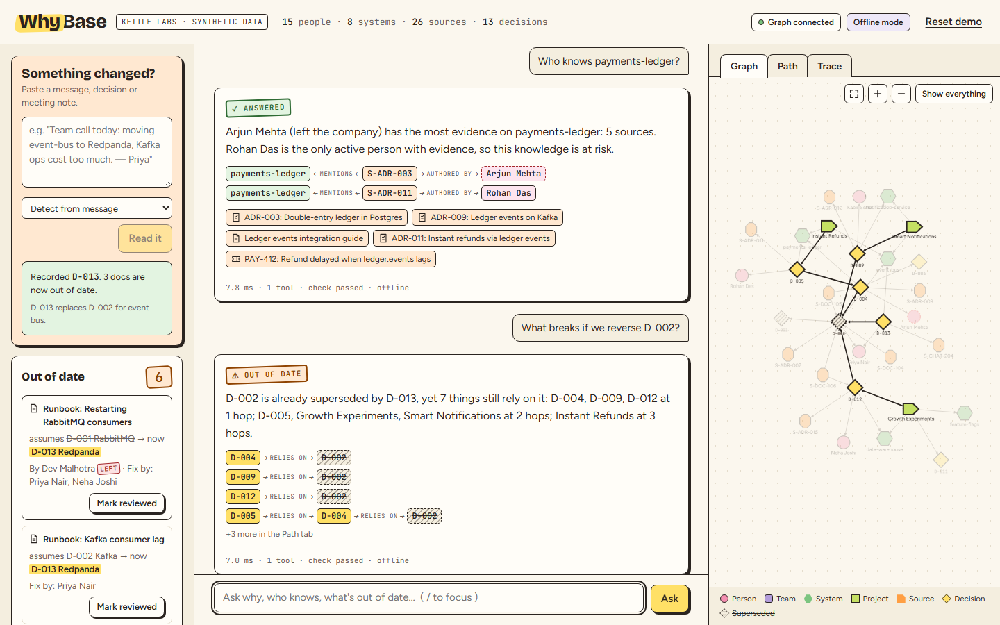
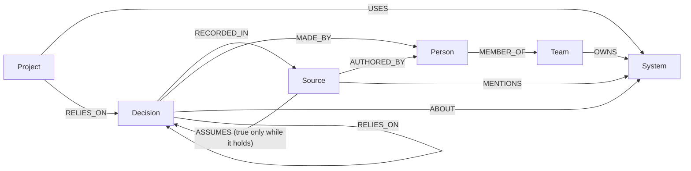
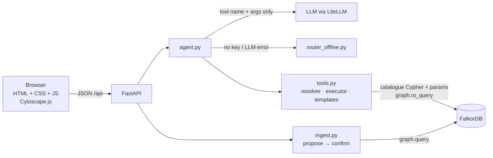

# WhyBase

**The company brain that knows why — and knows when it's out of date.**

WhyBase stores a company's people, teams, systems, projects, sources (docs, chats, tickets, ADRs) and decisions as one FalkorDB graph. You ask it questions. An agent answers by calling a fixed set of graph tools and shows the path it walked for every answer. When a new message changes a decision, WhyBase records it as a decision that `SUPERSEDES` the old one. It then flags every doc that `ASSUMES` the old decision as out of date, and routes the fix to the doc's author, or to an active teammate if the author has left.



**Track:** Track 03 — Company Brain · *Graph Hacks: Context for AI Agents* (WeMakeDevs × FalkorDB)

**Live demo:** <https://whybase.onrender.com> (free instance: the first load after a quiet spell takes about 50 s; the graph resets to Kettle Labs on every restart)

> All data is synthetic. Kettle Labs is a fictional company.

---

## Why a graph

Each of the six core questions is a traversal, not a search:

| Question | Traversal |
|---|---|
| *Why do we use X?* | `System ←ABOUT– Decision –SUPERSEDES*→ Decision –RECORDED_IN→ Source`, plus `MADE_BY → Person` |
| *Which docs are now wrong?* | `Source –ASSUMES→ Decision{superseded} ←SUPERSEDES*– Decision{active}`, then `AUTHORED_BY` and teammates via `MEMBER_OF` to route the fix |
| *Who knows X, and is it at risk?* | `System ←MENTIONS– Source –AUTHORED_BY→ Person`, counted per person and split into active and left |
| *What breaks if we reverse D?* | `(x)–RELIES_ON*1..3→ D`, multi-hop over decisions and projects |
| *What did we believe on date T?* | `Decision –ABOUT→ System` filtered on `at ≤ T < superseded_at` |
| *Which decisions are load-bearing?* | PageRank (`algo.pageRank`) over `Decision–RELIES_ON→Decision` |

A vector store can find a doc that *mentions* Kafka. It can't tell you that the doc is now wrong because ADR-007 was superseded yesterday, or that its author left in July. That needs the edges.

## Graph data model

| Label | Properties |
|---|---|
| `Person` | `name` (unique), `role`, `status` (`active`/`left`), `left_at` |
| `Team` | `name` (unique) |
| `System` | `name` (unique, kebab-case), `description` |
| `Project` | `name` (unique), `description` |
| `Source` | `id` (unique), `kind` (`doc`/`chat`/`ticket`/`adr`), `title`, `at`, `text`, `reviewed_at`, `reviewed_by` |
| `Decision` | `id` (unique, `D-001`…), `summary`, `at`, `status` (`active`/`superseded`), `superseded_at` |

Dates are ISO `YYYY-MM-DD` strings, so they compare correctly as strings. Indexes: `Person.name`, `Team.name`, `System.name`, `Project.name`, `Source.id`, `Decision.id`.



Seed (Kettle Labs, `data/seed.json`): 23 people, 6 teams, 13 systems, 10 projects, 47 sources and 21 decisions. The data includes three superseded decision chains with stale docs, two chains whose docs were already reviewed, people who left, multi-path dependencies, and a system nobody has written about.

## Architecture



- The LLM only picks a tool from a fixed catalogue and fills arguments. It never sees or writes Cypher.
- Every Cypher string is a hand-written file in `backend/queries/`, loaded by name. Values are always parameters. Reads use `graph.ro_query`, writes use `graph.query`.
- Paths, sources and highlights are built from query rows, never by the LLM.

## Every Cypher query the product depends on

These are the exact contents of `backend/queries/*.cypher`.

**`resolve_system.cypher`** — Resolve a system name (case-insensitive) before any traversal.

```cypher
MATCH (n:System) WHERE toLower(n.name) = toLower($name) RETURN n.name AS name
```

**`resolve_person.cypher`** — Resolve a person name.

```cypher
MATCH (n:Person) WHERE toLower(n.name) = toLower($name) RETURN n.name AS name
```

**`resolve_project.cypher`** — Resolve a project name.

```cypher
MATCH (n:Project) WHERE toLower(n.name) = toLower($name) RETURN n.name AS name
```

**`system_for_topic.cypher`** — Fallback resolver: a technology named in decisions about exactly one system (“KMS” → secrets-vault).

```cypher
MATCH (d:Decision)-[:ABOUT]->(s:System)
WHERE toLower(d.summary) CONTAINS toLower($q)
RETURN s.name AS name, d.id AS decision, d.summary AS summary
ORDER BY name, decision
```

**`resolve_decision.cypher`** — Resolve a decision by id or by words in its summary; several matches become clickable choices.

```cypher
MATCH (d:Decision)
WHERE d.id = toUpper($q) OR toLower(d.summary) CONTAINS toLower($q)
RETURN d.id AS id, d.summary AS summary, d.status AS status
ORDER BY d.at DESC LIMIT 3
```

**`why.cypher`** — Active decisions about a system and the SUPERSEDES chain behind each, with sources and deciders.

```cypher
MATCH (:System {name:$system})<-[:ABOUT]-(d:Decision {status:'active'})
MATCH p = (d)-[:SUPERSEDES*0..5]->(old:Decision)
MATCH (old)-[:RECORDED_IN]->(src:Source)
OPTIONAL MATCH (old)-[:MADE_BY]->(who:Person)
RETURN d.id AS head, length(p) AS step, old.id AS id, old.summary AS decision,
       old.at AS at, old.status AS status, src.id AS source_id, src.kind AS kind,
       src.title AS source, who.name AS by
ORDER BY head, step
```

**`stale_all.cypher`** — Every source that ASSUMES a superseded decision, what replaced it, and who should fix it.

```cypher
MATCH (src:Source)-[:ASSUMES]->(old:Decision {status:'superseded'})
MATCH (old)<-[:SUPERSEDES*1..5]-(head:Decision {status:'active'})
OPTIONAL MATCH (src)-[:AUTHORED_BY]->(author:Person)
OPTIONAL MATCH (author)-[:MEMBER_OF]->(:Team)<-[:MEMBER_OF]-(mate:Person {status:'active'})
OPTIONAL MATCH (src)-[:MENTIONS]->(:System)<-[:MENTIONS]-(other:Source)-[:AUTHORED_BY]->(mate)
WITH src, old, head, author, mate, count(DISTINCT other) AS know
ORDER BY know DESC, id(mate)
WITH src, old, head, author, collect(mate.name) AS mates
RETURN src.id AS source_id, src.title AS stale_doc, src.kind AS kind,
       old.id AS old_id, old.summary AS assumes,
       head.id AS now_id, head.summary AS now_true, head.at AS changed_at,
       author.name AS author, author.status AS author_status,
       CASE WHEN author.status = 'active' THEN [author.name] ELSE mates[..2] END AS fix_by
ORDER BY changed_at DESC, source_id
```

**`stale_for_decision.cypher`** — Sources made stale by one new decision (shown right after ingest).

```cypher
MATCH (new:Decision {id:$did})-[:SUPERSEDES]->(old:Decision)<-[:ASSUMES]-(src:Source)
OPTIONAL MATCH (src)-[:AUTHORED_BY]->(author:Person)
OPTIONAL MATCH (author)-[:MEMBER_OF]->(:Team)<-[:MEMBER_OF]-(mate:Person {status:'active'})
OPTIONAL MATCH (src)-[:MENTIONS]->(:System)<-[:MENTIONS]-(other:Source)-[:AUTHORED_BY]->(mate)
WITH src, old, new, author, mate, count(DISTINCT other) AS know
ORDER BY know DESC, id(mate)
WITH src, old, new, author, collect(mate.name) AS mates
RETURN src.id AS source_id, src.title AS stale_doc, src.kind AS kind,
       old.id AS old_id, old.summary AS assumes,
       new.id AS now_id, new.summary AS now_true, author.name AS author, author.status AS author_status,
       CASE WHEN author.status = 'active' THEN [author.name] ELSE mates[..2] END AS fix_by
ORDER BY source_id
```

**`mark_reviewed.cypher`** — Fix a stale doc: re-point its ASSUMES edge to the active head decision.

```cypher
MATCH (src:Source {id:$sid})-[r:ASSUMES]->(old:Decision {id:$old_id})
MATCH (old)<-[:SUPERSEDES*1..5]-(head:Decision {status:'active'})
DELETE r
CREATE (src)-[:ASSUMES]->(head)
SET src.reviewed_at = $now, src.reviewed_by = $by
RETURN src.id AS source_id, head.id AS now_assumes
```

**`who_knows.cypher`** — People ranked by how many sources about a system they wrote.

```cypher
MATCH (:System {name:$system})<-[:MENTIONS]-(src:Source)-[:AUTHORED_BY]->(p:Person)
OPTIONAL MATCH (p)-[:MEMBER_OF]->(t:Team)
WITH p, t, count(DISTINCT src) AS evidence,
     collect(DISTINCT src.title)[..3] AS via, collect(DISTINCT src.id)[..3] AS via_ids
RETURN p.name AS person, p.role AS role, t.name AS team, p.status AS status, evidence, via, via_ids
ORDER BY evidence DESC, person LIMIT 5
```

**`knowledge_risk.cypher`** — Systems known by at most one active person.

```cypher
MATCH (s:System)<-[:MENTIONS]-(:Source)-[:AUTHORED_BY]->(p:Person)
WITH s, collect(DISTINCT p) AS people
WITH s, [x IN people WHERE x.status = 'active' | x.name] AS active,
        [x IN people WHERE x.status = 'left'   | x.name] AS gone
WHERE size(active) <= 1
RETURN s.name AS system, active, gone
ORDER BY size(gone) DESC, system
```

**`reversal_impact.cypher`** — Decisions and projects that RELIES_ON a decision, up to 3 hops, with the path.

```cypher
MATCH p = (x)-[:RELIES_ON*1..3]->(:Decision {id:$id})
RETURN DISTINCT coalesce(x.name, x.id) AS affected,
       CASE WHEN x:Project THEN 'Project' ELSE 'Decision' END AS kind,
       coalesce(x.summary, x.description) AS detail,
       length(p) AS hops,
       [n IN nodes(p) | coalesce(n.name, n.id)] AS via
ORDER BY hops, affected
```

**`load_bearing.cypher`** — PageRank over Decision–RELIES_ON→Decision.

```cypher
CALL algo.pageRank('Decision', 'RELIES_ON')
YIELD node, score
RETURN node.id AS id, node.summary AS decision, node.status AS status, score
ORDER BY score DESC LIMIT $limit
```

**`as_of.cypher`** — What Kettle Labs believed about a system on a given date.

```cypher
MATCH (d:Decision)-[:ABOUT]->(:System {name:$system})
WHERE d.at <= $date AND (d.superseded_at IS NULL OR d.superseded_at > $date)
OPTIONAL MATCH (d)-[:RECORDED_IN]->(src:Source)
RETURN d.id AS id, d.summary AS believed, d.at AS since, d.status AS status,
       src.id AS source_id, src.title AS source
ORDER BY since DESC
```

**`current_head.cypher`** — The active decision that replaced a superseded one.

```cypher
MATCH (old:Decision {id:$id})<-[:SUPERSEDES*1..5]-(head:Decision {status:'active'})
RETURN head.id AS id, head.summary AS summary, head.at AS at
```

**`candidates_for_system.cypher`** — Active decisions about a system: the only ones an ingested message may replace.

```cypher
MATCH (d:Decision {status:'active'})-[:ABOUT]->(:System {name:$system})
RETURN d.id AS id, d.summary AS summary, d.at AS at ORDER BY at DESC
```

**`next_ids.cypher`** — Highest decision and chat-source ids, used to mint D-0NN and S-CHAT-2NN.

```cypher
MATCH (d:Decision)
WITH max(d.id) AS max_decision
OPTIONAL MATCH (s:Source) WHERE s.id STARTS WITH 'S-CHAT-'
RETURN max_decision, max(s.id) AS max_chat
```

**`ingest_decision.cypher`** — Write the new Source and Decision with ABOUT, MADE_BY and SUPERSEDES; mark the old one superseded.

```cypher
MATCH (s:System {name:$system}), (old:Decision {id:$old}), (p:Person {name:$author})
CREATE (src:Source {id:$sid, kind:'chat', title:$title, text:$text, at:$at})-[:AUTHORED_BY]->(p)
CREATE (d:Decision {id:$did, summary:$summary, at:$at, status:'active'})-[:RECORDED_IN]->(src)
CREATE (d)-[:ABOUT]->(s), (d)-[:MADE_BY]->(p), (d)-[:SUPERSEDES]->(old), (src)-[:MENTIONS]->(s)
SET old.status = 'superseded', old.superseded_at = $at
RETURN d.id AS id
```

**`subgraph.cypher`** — Given node names/ids, return them, their 1-hop neighbours and the edges (graph view).

```cypher
MATCH (n) WHERE n.name IN $names OR n.id IN $names
OPTIONAL MATCH (n)-[r]-(m)
RETURN n, r, m
```

**`full_graph.cypher`** — Everything, for “Show everything”.

```cypher
MATCH (n)
OPTIONAL MATCH (n)-[r]->(m)
RETURN n, r, m
```

**`entities.cypher`** — Names for autocomplete, the answer check and the offline router.

```cypher
MATCH (n)
WHERE n:System OR n:Person OR n:Project OR n:Decision
OPTIONAL MATCH (n)-[:ABOUT]->(s:System)
RETURN labels(n)[0] AS kind, coalesce(n.name, n.id) AS name, n.status AS status,
       n.summary AS summary, s.name AS about
ORDER BY kind, name
```

**`sources_by_ids.cypher`** — Title, kind, date and author for source chips.

```cypher
MATCH (s:Source) WHERE s.id IN $ids
OPTIONAL MATCH (s)-[:AUTHORED_BY]->(p:Person)
RETURN s.id AS id, s.title AS title, s.kind AS kind, s.at AS at, p.name AS author
```

**`stats.cypher`** — Node counts per label for the header.

```cypher
MATCH (n) RETURN labels(n)[0] AS label, count(n) AS c
```

**`count_nodes.cypher`** — Is the graph empty? (auto-seed on startup)

```cypher
MATCH (n) RETURN count(n) AS c
```

### Seed loaders

**`seed_assumes.cypher`** — Loader used by `seed.py` (UNWIND over `data/seed.json`).

```cypher
UNWIND $pairs AS pair
MATCH (a:Source {id: pair[0]}), (b:Decision {id: pair[1]})
CREATE (a)-[:ASSUMES]->(b)
```

**`seed_decision_relies.cypher`** — Loader used by `seed.py` (UNWIND over `data/seed.json`).

```cypher
UNWIND $pairs AS pair
MATCH (a:Decision {id: pair[0]}), (b:Decision {id: pair[1]})
CREATE (a)-[:RELIES_ON]->(b)
```

**`seed_decisions.cypher`** — Loader used by `seed.py` (UNWIND over `data/seed.json`).

```cypher
UNWIND $decisions AS d
MATCH (s:System {name: d.about}), (p:Person {name: d.made_by}), (src:Source {id: d.recorded_in})
CREATE (n:Decision {id: d.id, summary: d.summary, at: d.at, status: d.status, superseded_at: d.superseded_at})
CREATE (n)-[:RECORDED_IN]->(src), (n)-[:ABOUT]->(s), (n)-[:MADE_BY]->(p)
```

**`seed_people.cypher`** — Loader used by `seed.py` (UNWIND over `data/seed.json`).

```cypher
UNWIND $people AS p
MATCH (t:Team {name: p.team})
CREATE (:Person {name: p.name, role: p.role, status: p.status, left_at: p.left_at})-[:MEMBER_OF]->(t)
```

**`seed_project_relies.cypher`** — Loader used by `seed.py` (UNWIND over `data/seed.json`).

```cypher
UNWIND $pairs AS pair
MATCH (a:Project {name: pair[0]}), (b:Decision {id: pair[1]})
CREATE (a)-[:RELIES_ON]->(b)
```

**`seed_projects.cypher`** — Loader used by `seed.py` (UNWIND over `data/seed.json`).

```cypher
UNWIND $projects AS p
CREATE (pr:Project {name: p.name, description: p.description})
WITH pr, p
UNWIND p.uses AS u
MATCH (s:System {name: u})
CREATE (pr)-[:USES]->(s)
```

**`seed_sources.cypher`** — Loader used by `seed.py` (UNWIND over `data/seed.json`).

```cypher
UNWIND $sources AS s
MATCH (a:Person {name: s.author})
CREATE (src:Source {id: s.id, kind: s.kind, title: s.title, at: s.at, text: s.text,
                    reviewed_at: s.reviewed_at, reviewed_by: s.reviewed_by})-[:AUTHORED_BY]->(a)
WITH src, s
UNWIND s.mentions AS m
MATCH (sys:System {name: m})
CREATE (src)-[:MENTIONS]->(sys)
```

**`seed_supersedes.cypher`** — Loader used by `seed.py` (UNWIND over `data/seed.json`).

```cypher
UNWIND $pairs AS pair
MATCH (a:Decision {id: pair[0]}), (b:Decision {id: pair[1]})
CREATE (a)-[:SUPERSEDES]->(b)
```

**`seed_systems.cypher`** — Loader used by `seed.py` (UNWIND over `data/seed.json`).

```cypher
UNWIND $systems AS s
MATCH (t:Team {name: s.team})
CREATE (t)-[:OWNS]->(:System {name: s.name, description: s.description})
```

**`seed_teams.cypher`** — Loader used by `seed.py` (UNWIND over `data/seed.json`).

```cypher
UNWIND $teams AS t
CREATE (:Team {name: t.name})
```


## Setup

**Prerequisites:** Docker (with Compose v2). For local dev: Python 3.12+.

```bash
cp .env.example .env          # optional: set LLM_MODEL and a provider key
make up                       # FalkorDB + app in Docker
make seed                     # wipe and load Kettle Labs (the app also auto-seeds an empty graph)
```

- App: <http://localhost:8000>
- FalkorDB Browser: <http://localhost:3000> (connect to `localhost:6379`, graph `whybase`)

**Slow network?** Building the image downloads about 80 Python wheels. If Docker's network is slow, download them on the host first with `make wheels`; the image then installs from `./wheels` with no network at all. `requirements.lock` pins the exact Linux set, and `make lock` refreshes it from a running container.

**Without `make` (e.g. Windows):**

```bash
docker compose up -d --build
docker compose exec app python -m backend.seed
```

**Local dev** (app on your machine, FalkorDB in Docker):

```bash
docker compose up -d falkordb
python -m venv .venv && . .venv/bin/activate      # Windows: .venv\Scripts\activate
pip install -r requirements.txt
python -m backend.seed
python -m uvicorn backend.main:app --reload --port 8000
```

### LLM or offline mode

Set `LLM_MODEL` (any [LiteLLM](https://docs.litellm.ai/docs/providers) model string) and the provider's usual key variable in `.env`. We tested with Gemini:

```bash
LLM_MODEL=gemini/gemini-3.1-flash-lite
GEMINI_API_KEY=...
```

Other providers work the same way, e.g. `anthropic/claude-sonnet-5-5` with `ANTHROPIC_API_KEY`, or `openai/gpt-4o-mini` with `OPENAI_API_KEY`. With no model or no key, the header shows **Offline mode**: a keyword router picks the tool and template sentences are used. The whole demo works offline.

How a slow or failing LLM is handled:

- If an LLM call errors, is rate-limited, or takes longer than 15 s, that question falls back to the offline router, and the trace says so.
- If a question has already spent 20 s in the LLM loop, WhyBase stops calling the model and answers from the tool results it already has, using the template sentence.

> **Gemini free tier:** each question uses about 2 requests, and free quotas are per model. `gemini-3.8-flash` allows only 20 requests a day, so we default to `gemini-3.1-flash-lite`. When a quota runs out, the header shows **LLM quota hit · offline** and answers come from the offline router until the provider's retry time. They are still correct and marked in the trace.

### Deploying

See **[docs/DEPLOY.md](docs/DEPLOY.md)** for one VM with Docker Compose, or FalkorDB Cloud plus Render, Railway or Fly.io.

### FalkorDB Cloud

Only environment variables change:

```bash
FALKOR_HOST=<your-instance-host>
FALKOR_PORT=<port>
FALKOR_USERNAME=<user>
FALKOR_PASSWORD=<password>
FALKOR_SSL=true               # if the instance requires TLS
GRAPH_NAME=whybase
```

## Demo walkthrough (~3 minutes)

Want more than the demo? **[docs/TESTING_GUIDE.md](docs/TESTING_GUIDE.md)** lists 26 questions and 5 changes with expected results. In the app, use the **Examples** button next to the question box, or **Try an example…** in *Something changed?*.

1. Ask **"Why do we use Kafka for the event bus?"** → ✓ ANSWERED. The chain is `event-bus ← ABOUT ← D-002 → SUPERSEDES → D-001`, with ADR-007 and ADR-001, decided by Priya Nair and Dev Malhotra. The graph highlights the path.
2. Desk → **At risk → payments-ledger** → "Who knows payments-ledger?" Arjun Mehta (LEFT) wrote 5 sources; Rohan Das is the only active person left.
3. **Live change.** Paste into *Something changed?*:
   *"Team call today: we're moving event-bus from Kafka to Redpanda — Kafka ops cost is too high and Redpanda speaks the Kafka API. — Priya Nair"*
   → **Read it** → proposal (event-bus, replaces D-002, decided by Priya Nair; nothing written yet) → **Confirm & record**. D-022 is created and the stale counter goes 3 → 6. Three docs flash orange: S-DOC-104, S-DOC-105, S-DOC-106. The ledger guide's author has left, so the fix goes to Rohan Das and Ishaan Kapoor.
4. Ask **"What breaks if we reverse D-002?"** → 7 items up to 3 hops, including Instant Refunds via D-005 → D-004. D-002 is now marked as already superseded. Open **Load-bearing decisions**: D-002 is #1 by PageRank.
5. **Time travel:** event-bus on **2025-01-01** → *Use RabbitMQ as the event bus*.
6. Ask **"Who knows quantum-cache?"** → ✕ UNKNOWN. Only the resolver ran; no traversal.
7. Open the **Trace** tab: tools, rows, ms, check result and **Copy Cypher**.

Ask "Why do we use Kafka for the event bus?" again after step 3: it now comes back ⚠ OUT OF DATE and points to D-022. **Reset demo** (header) restores the original graph.

## Guardrails

- **Fixed tools.** `why`, `stale_docs`, `who_knows`, `knowledge_risk`, `reversal_impact`, `load_bearing`, `as_of`. Each maps to one catalogue query. Unknown tool names are rejected.
- **Resolver first.** Every system or decision the LLM (or router) names is resolved against the graph before any traversal. If it doesn't resolve, the outcome is `unknown` and nothing else runs. An ambiguous decision returns clickable choices.
- **Four outcomes.** `answered` · `stale_warning` · `no_connection` · `unknown`. Each is shown as a stamp with an icon and a word, never colour alone.
- **Answer check.** Every person, system or project name, decision id or kebab-case token in the model's sentence must appear in the returned rows. If one doesn't, the sentence is replaced by a template built from the rows, and the footer says which name failed.
- **Confirm before write.** Ingest only proposes. The LLM can pick the replaced decision only from the graph's list of active candidates. Nothing is written until **Confirm & record**, and the confirm step validates everything against the graph again.
- **Limits.** Max 4 tool calls, temperature 0, 15 s LLM timeout, 500-char questions, 2,000-char ingest text, same-origin only.

## Testing

```bash
make test                      # or: python -m pytest -q   (needs FalkorDB on localhost:6379)
```

The tests run against a separate graph (`whybase_test`):

- `tests/test_queries.py` runs every catalogue query against the seed and asserts the fixture properties: 3 stale docs, the risk list, reversal hops, PageRank order, time travel, and the write path.
- `tests/test_agent.py` covers the resolver, all four outcomes and the offline router. It also tests the LLM loop with a mocked LLM: answer-check replacement, the 4-call cap, timeout fallback and unknown tools.
- `tests/test_examples.py` checks every sample in `data/examples.json` (26 questions, 5 recorded changes) against its documented result.
- `tests/test_api.py` covers the endpoints, the full live-change flow (FR-8 to FR-10, FR-15), validation errors, and the 503 returned when FalkorDB is down.

## Project layout

```
backend/   main.py (API) · db.py (ro/rw helpers) · seed.py · tools.py · agent.py · router_offline.py · ingest.py · models.py · queries/*.cypher
frontend/  index.html · styles.css · app.js · graph.js · api.js        (no build step)
data/      seed.json (Kettle Labs)
tests/     test_queries.py · test_agent.py · test_api.py
```

## Data note

Kettle Labs, its people and every document are synthetic, written for this demo. No real people or private data.

## More

- [AI_DISCLOSURE.md](AI_DISCLOSURE.md): how AI assistants were used.
- [DECISIONS.md](DECISIONS.md): choices made where the spec was ambiguous.
- **Team:** Samina Parveen, Madhur Tandon, Aditya Karn
- **Licence:** [MIT](LICENSE)
